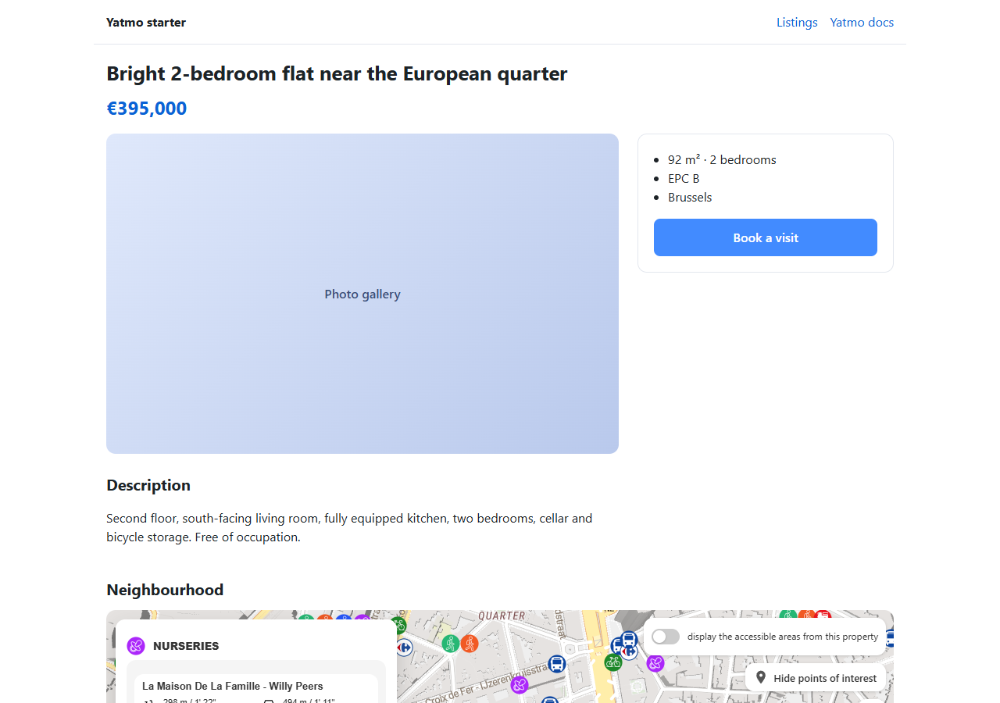

# Yatmo Next.js starter: real estate listing pages with neighbourhood data

Build a modern property page with Next.js and [Yatmo](https://yatmo.com): the interactive neighbourhood map with
points of interest and travel times, the nearest schools, nurseries, supermarkets and public transport, and a written
neighbourhood text rendered on the server so search engines and AI assistants index it. App Router, React server
components, TypeScript, JSON-LD, cached Yatmo calls. 25 countries, 23 languages.

<p align="center">
  
</p>

[](https://vercel.com/new/clone?repository-url=https://github.com/Yatmo/yatmo-nextjs-starter&env=YATMO_BACKEND_KEY,NEXT_PUBLIC_YATMO_FRONTEND_KEY,YATMO_COUNTRY&envDescription=Your%20Yatmo%20keys%20and%20country&envLink=https://documentation.yatmo.com/license)

## Run it in 5 minutes

1. Get a Yatmo licence key at [yatmo.com](https://yatmo.com): the **backend** key for the server, the **frontend**
   key for the map (locked to your domains; add `localhost` while developing). [Keys explained](https://documentation.yatmo.com/license).
2. Use this template (button on GitHub) or clone it, then:

```bash
npm install
cp .env.example .env.local      # fill in the two keys and the country
npm run dev                     # http://localhost:3000
```

Three sample listings are in `lib/listings.ts`; replace them with your API or database.

## What the listing page does

| Part | How | File |
|---|---|---|
| Map, points of interest, travel times, isochrones, routes | `<YatmoMap>` from `@yatmo/react`: one iframe built on the server with the frontend key, no client JavaScript | `app/listings/[id]/page.tsx` |
| Nearest schools, nurseries, shops, public transport with walking times | `<YatmoPois summary={...}>` with data fetched on the server | `app/listings/[id]/page.tsx` |
| Neighbourhood text (education, shopping, transport, roads, leisure, nearby cities) | `<YatmoNeighbourhoodText text={...}>` with data fetched on the server: part of the HTML, indexable | `app/listings/[id]/page.tsx` |
| Yatmo calls | `@yatmo/sdk` with the backend key, cached 30 days with `unstable_cache` | `lib/yatmo.ts` |
| SEO | `generateMetadata` builds the description from the first neighbourhood sentence; JSON-LD `RealEstateListing` | `app/listings/[id]/page.tsx` |
| Discreet listings | `discreet: true` shows a circle instead of the pin, keeps the street out of the titles and the coordinates out of the JSON-LD | `lib/listings.ts` |

Pages are rendered on the first request and revalidated daily; the Yatmo answers are cached for 30 days, since a
neighbourhood rarely changes. Nothing is fetched at build time, so `npm run build` works without keys.

## Going further

- Search by travel time, listings on the map and the other map features: [JavaScript plugin](https://documentation.yatmo.com/plugins/js-map), `<YatmoInteractiveMap>` in [@yatmo/react](https://www.npmjs.com/package/@yatmo/react).
- Scores, listing enrichment, isochrones, routes, geocoding, static map images: [@yatmo/sdk](https://www.npmjs.com/package/@yatmo/sdk) and the [API](https://documentation.yatmo.com/api).
- Other stacks: [Vue and Nuxt](https://www.npmjs.com/package/@yatmo/vue), [web components for any site](https://www.npmjs.com/package/@yatmo/elements), [WordPress](https://wordpress.org/plugins/yatmo-map/), [Odoo](https://apps.odoo.com/apps/modules/20.0/yatmo_map), [mobile SDKs](https://github.com/Yatmo).

MIT licence. Yatmo is a paid service for real estate portals, agency networks and developers; a licence key is required.
